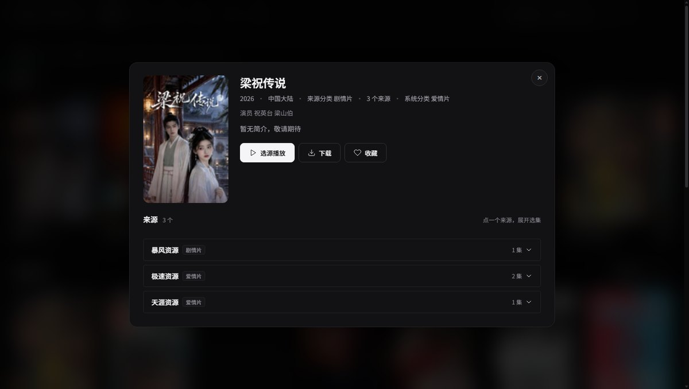
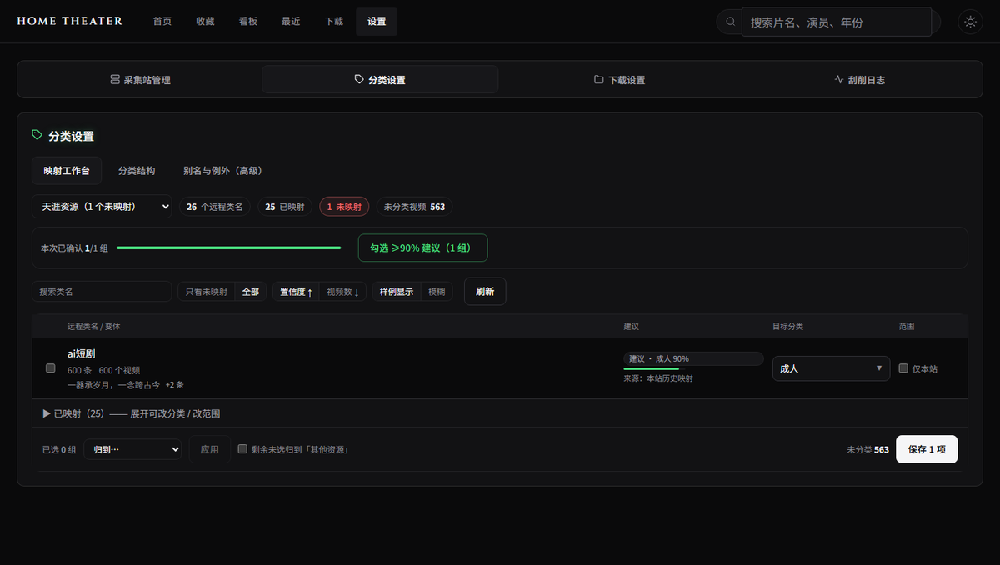

# Home Theater

个人视频聚合系统。配置多个采集站（资源站），后端并发拉取并按「名称 + 年份」聚合去重，前端以卡片网格展示。播放与下载时由用户**显式选择来源**。支持播放进度记录、收藏、断点续传下载。

本机或局域网访问，纯 Python 部署。

## 界面

首页：分类栏（含搜索）、推荐横条、全部视频卡片墙。


详情：**来源分类**（采集站的原始类名）与**系统分类**（聚合后的归类结果）并列，一眼看出系统是怎么归的类。



分类映射工作台：按站点列出远程类名，自动聚类、给建议、批量保存，可一键撤销。



## 特性

**采集与聚合**

- 多源并发采集，按「规范化名称 + 年份」聚合去重；首页与搜索走本地预聚合表
- 聚合行按 `(norm_title, year)` 唯一，增量刷新走 upsert，并发写入不会让整批失败
- 站点健康探测、自动禁用 / 恢复；增量抓取单次限 30 页，避免和前台抢资源

**分类**

- 48 个系统分类（7 大类 + 41 小类），支持增删改；改名/删除会级联更新别名与视频分类
- 全局别名（远程类名 → 系统分类，跨站共享）+ 站点例外 + 视频级多数票
- **映射工作台**：按站点把类名聚成组（编辑相似度 ≥ 0.75），建议来源优先级为
  「本站历史映射 > 关键词规则 > 名称相似」；置信度 ≤70% 不预填；批量 upsert 后立即重算，
  支持撤销与完成态引导
- 可搜索的分类选择器，支持就地「新建分类」；分类栏支持搜索与最近使用
- 详情页并列展示来源分类与系统分类；未分类内容可在工作台诊断原因并一键归类

**播放与下载**

- 显式选源播放 / 下载，xgplayer 支持 HLS/MP4/WebM
- 12 秒无首帧先提示「线路较慢」继续缓冲，30 秒才判失败；播放前对 m3u8 做 HEAD 探测并标记不可达线路
- **播放加速**（可选）：m3u8 分片经本机后端多连接拉取并缓存，绕过资源站单连接限速；
  一档 2 / 二档 4 / 三档 8 / 狂暴 16 并发，默认关闭
- 播放进度记忆、收藏、断点续传下载；m3u8 并发分片下载，ffmpeg 合并失败时降级拼接

**体验与运维**

- **清除失效资源**：全站扫描（按 id 游标断点续跑），连续两轮都没被资源站返回才删除；
  后台任务 + 进度条，可随时停止；四档限速（省流 2 / 标准 6 / 快速 16 请求每秒）避免占满带宽
- 深色 / 浅色双主题，响应式布局；移动端只读浏览，不提供映射配置
- 更新自愈：旧 HTML 引用失效 chunk 时自动带 `_r` 重载，不会白屏
- 事件循环看门狗 + 慢请求日志，排查卡顿先看这两个

## 性能（本地库实测）

| 场景 | 耗时 |
|---|---|
| 首页 / 分类列表 | 40ms 级 |
| 搜索（3 字以上，pg_trgm） | 20ms 级 |
| 详情（多源） | 20–40ms |
| 分类映射工作台（接口） | 414ms 冷 / 7ms 热（按站点缓存 2 分钟） |
| 进入「设置 → 分类」到内容出现 | 258ms（再次进入） |
| 清除失效资源 | 全站约 85 万条 / 约 55 分钟；省流档约 46KB/s |
| 播放加速（分片缓存命中） | 47–105ms；二次播放 1.0s（未启用时 8.8s） |

- 两个反例：45 万行取回 Python 循环卡 4.7 秒；请求路径里 `ssl.create_default_context()`
  卡 45 秒。统一改为 SQL 下推与进程级共享 SSLContext。
- 详细规则见本地 `AGENTS.md` 的 §15 性能检查清单（个人文件，不入库）

## 技术栈

| 层级 | 技术 |
|------|------|
| 后端 | Python 3.13, FastAPI, SQLAlchemy(async), asyncpg, httpx |
| 前端 | React 18, Vite, TypeScript, react-router-dom, framer-motion |
| 播放器 | xgplayer v3 + xgplayer-hls.js |
| 数据库 | PostgreSQL 16+ |
| 部署 | uvicorn / Docker |

## 快速开始

前提：Python 3.11+、Node.js 18+、PostgreSQL 16+。

```powershell
# 1. 配置后端环境
cd backend
copy .env.example .env
# 编辑 .env，设置 DATABASE_URL

# 2. 安装依赖
cd backend && pip install -e .
cd frontend && npm install

# 3. 启动（Windows）
.\start.cmd        # 生产模式（推荐：绕过 PowerShell 执行策略）
.\start.cmd -Dev   # 开发模式
.\stop.cmd         # 停止

# 等价写法（若执行策略允许未签名脚本）
.\start.ps1
.\stop.ps1
```

Docker：

```bash
docker compose up --build -d
```

完整 PostgreSQL 安装、数据库初始化与部署细节见 [docs/setup.md](docs/setup.md)。

## 常用命令

| 命令 | 说明 |
|------|------|
| `cd backend && python -m uvicorn app.main:app --host 0.0.0.0 --port 8000 --reload` | 后端开发 |
| `cd frontend && npm run dev` | 前端开发 |
| `cd frontend && npm run build` | 构建前端 |
| `cd frontend && npm run typecheck && npm run test` | 前端类型检查与测试 |
| `cd backend && pytest` | 后端测试 |
| `.\start.cmd` / `.\stop.cmd` | Windows 一键启停 |
| `docker compose up --build -d` | Docker 部署 |

## 项目结构

```
Home Theater/
├── backend/         # FastAPI + 业务逻辑 + PostgreSQL 初始化脚本
├── frontend/        # React + Vite SPA
├── docs/            # 部署、踩坑、设计规格；assets/screenshots 为界面截图
├── start.ps1        # Windows 一键启动（start.cmd 为绕过执行策略的包装器）
├── stop.ps1         # Windows 一键停止
└── docker-compose.yml
```

## 文档索引

- [部署与数据库配置](docs/setup.md)
- [踩坑记录](docs/lessons-learned.md)
- 项目规范（含性能检查清单）：本地 `AGENTS.md`（个人文件，不入库）
- [设计系统](DESIGN.md)
- [产品定位](PRODUCT.md)
- [系统注册表](docs/registry/system-context.md)

## 核心规范

采集站参数、播放地址解析、分类体系、显式选源、性能红线等硬规范详见本地 `AGENTS.md`（个人文件，不入库）。
